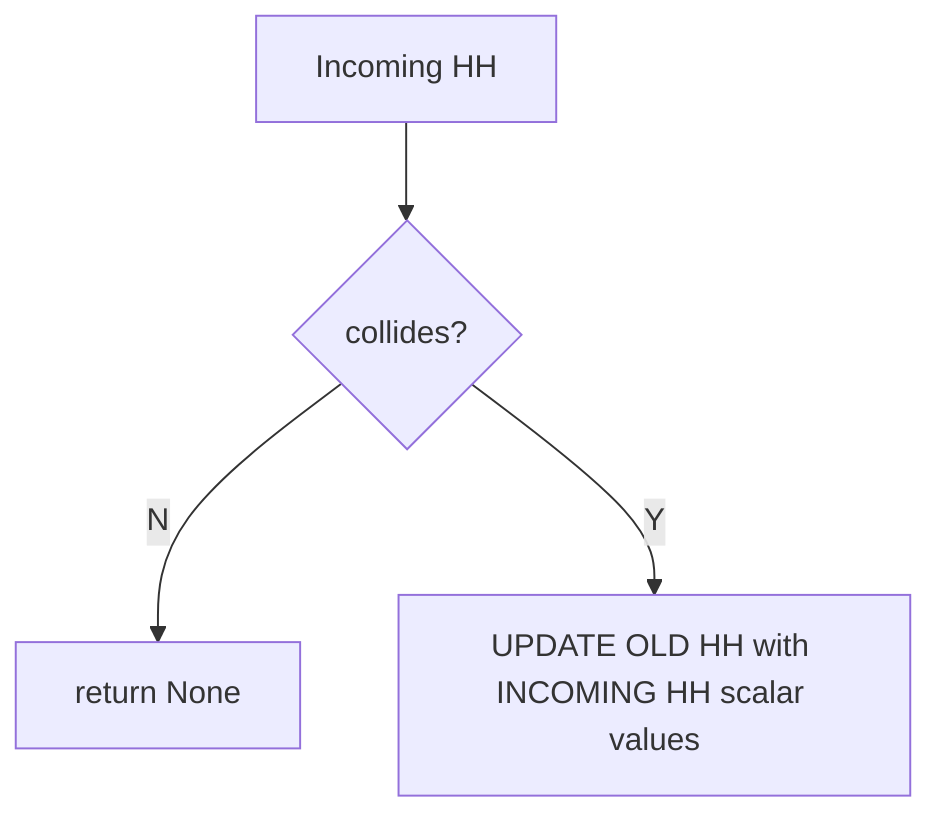
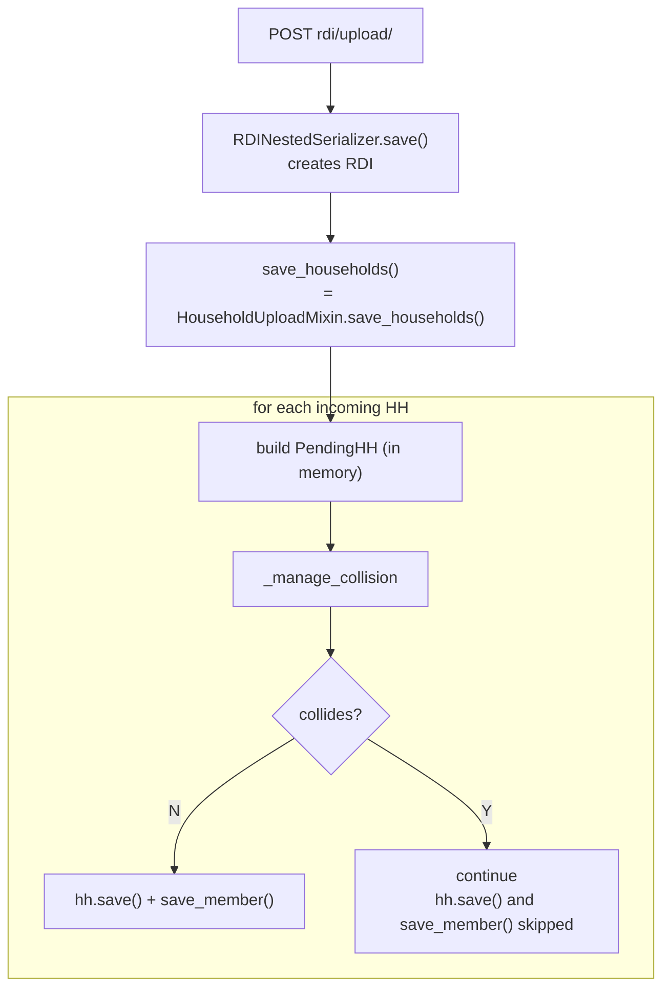
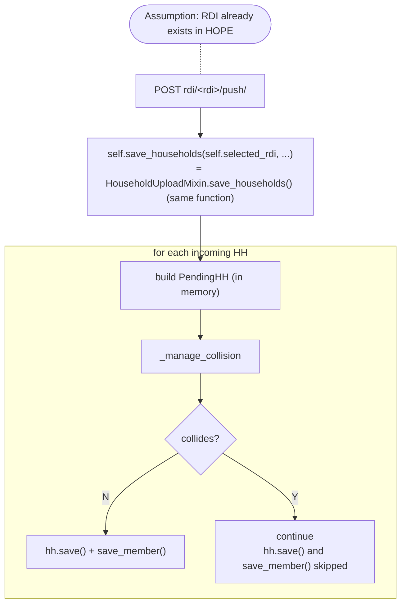
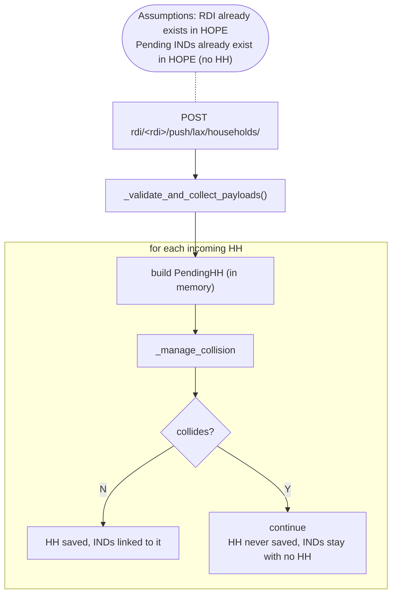
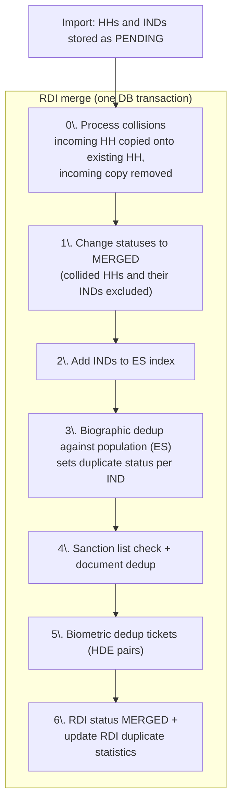

# Collisions & Merge — DEMO

Source lines refer to `develop` @ `f9109a5938`.

## Glossary

- **Identification key** — external ID of a household or individual, used to tell whether the same record came back.
- **Collision** — an incoming household has the same identification key as a household already in the population.
- **Collision-merge** — copy the incoming data onto the existing household, then delete the incoming copy.
- **Withdraw** — a member missing from the incoming household is withdrawn, not deleted, and their documents are invalidated.
- **Sanction check** — compare incoming individuals with sanction lists and flag matches with a ticket.
- **Dedup ticket** — grievance ticket asking a person to decide whether two individuals are the same.
- **Batch statistics** — per-RDI counts of unique and duplicate individuals, shown before and after the merge.

## API Ingestion paths

API endpoints that resolve collisions at upload time (prefix `/api/rest/<business_area>/`):

| Endpoint | Location | Comment |
|---|---|---|
| `POST rdi/upload/` | `src/hope/api/endpoints/rdi/upload.py:349` | One request carries RDI, HHs and members. |
| `POST rdi/<rdi>/push/` | `src/hope/api/endpoints/rdi/base.py:116` | RDI already exists in HOPE. Request carries HHs with nested INDs. |
| `POST rdi/<rdi>/push/lax/households/` | `src/hope/api/endpoints/rdi/lax.py:626` | RDI already exists in HOPE. Individuals already pushed as pending. Request carries HHs and IND ids to connect everything using HHs. |

### Problem

All listed paths ends up in

```python
class HouseholdUploadMixin(DocumentMixin, AccountMixin, PhotoMixin):
    def _manage_collision(...) -> str | None:
        ...
```



**Important: `_manage_collision` updates ONLY HHs scalar values.**


### How this impacts listed ingestion paths?

**POST rdi/upload/ (UploadRDIView)**



Result:
1. Existing HH updated with new scalar data right after coming into HOPE.
2. INDs assigned to incoming HH are not saved (`save_member` not called).

**POST rdi/<rdi>/push/ (PushToRDIView)**



Result:
1. Existing HH updated with new data right after coming into HOPE.
2. INDs assigned to incoming HH are not saved (`save_member` not called).

Example — member skipped (same for `rdi/upload/`)

Assumptions:

- The program has collision detection ENABLED.
- Population (merged): household with key `HH-1`, one member Bob with key `IND-B`.
- The push sends a household with the same key `HH-1`, so it collides.

| | HH-1 members |
|---|---|
| Population | Bob (`IND-B`) |
| Push | Bob (`IND-B`), Anna (`IND-A`, new) |
| Result | Bob (`IND-B`), HH-1 fields updated |

Anna never reaches HOPE.

**POST rdi/<rdi>/push/lax/households/ (CreateLaxHouseholds)**



Result:
1. Existing HH updated with new data right after coming into HOPE.
2. New HH is removed.
3. INDs got abandoned and can be merged without HH assigned

Example — pending INDs orphaned

Assumptions:

- The program has collision detection ENABLED.
- Population (merged): household with key `HH-1`, one member Bob with key `IND-B`.
- The push sends a household with the same key `HH-1`, so it collides.
- Bob (`IND-B`) and Anna (`IND-A`) were already pushed as pending individuals in this RDI.

| | HH-1 members | No household |
|---|---|---|
| Population | Bob (`IND-B`) | |
| Push | Bob (`IND-B`), Anna (`IND-A`) | |
| Result | Bob (`IND-B`), HH-1 fields updated | Bob (`IND-B`), Anna (`IND-A`) |

After the RDI merge, Bob is in the population twice and both new records have no household.

## Other Ingestion paths (e.g. XLSX)

These paths never call `_manage_collision`. They store everything as pending and handle collisions at merge time in `RdiMergeTask.execute` (`src/hope/apps/registration_data/tasks/rdi_merge.py:165`).




## Open questions

1. https://github.com/unicef/hope/pull/6525#discussion_r4561585374
    ```
    Does CW has a way to specify identification_key when pushing individuals? Or will it always be None here? @ntrncic
    ```
    TODO: Add more context to that
