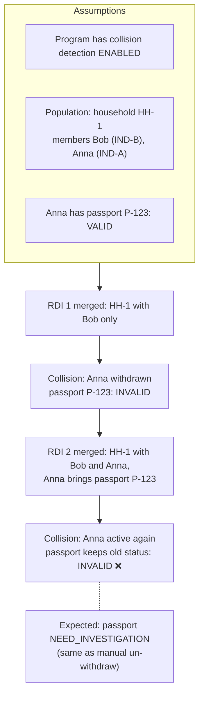

# Review findings

## Returning member keeps INVALID documents

Exists on develop and on the PR branch.



**Fix**

_restore_removed_by_collision on the PR branch (collision_detectors.py:266), inside the branch
  that sets withdrawn = False:
```diff
        if removed.get("withdrawn_by_collision", True):
            data["withdrawn"] = False
            data["withdrawn_date"] = None
+           destination.documents(manager="all_objects").update(status=Document.STATUS_NEED_INVESTIGATION)
```

## Sanction check

sanction check runs after the collision and looks only at the incoming RDI's people.

Assumptions
  - The program has collision detection and a sanction list enabled.
  - Population: household HH-1 with head "Clean Person" (IND-1), who is not on the sanction list.
  - The incoming RDI has screening turned on.

Steps
1. The incoming RDI brings HH-1 again. Its head, IND-1, now has the name and birth date of someone on the sanction list ("Alias Name2", born 1922).
2. During the merge, the collision copies that identity onto the existing person, who is now "Alias Name2". The incoming copy is deleted.
3. The sanction check runs afterwards. It only screens people who belong to the incoming RDI. The updated person still belongs to the old RDI, so the check skips them.

**Fix**

Collision-updated individual needs to be screened again against sanction lists.

## Moved biometric pair does not create a ticket

Problem: https://claude.ai/artifact/MNT6DFkJcY18jXqPKAmxG3

**Fix**

pass new, rewritten pairs explicitly to create adjudication ticket service. Tickets must be new to the old record (there should be no such ticket in the past so user does not need to take the same action twice). Ticket is reported as the population <-> population duplicate (not from the RDI).


!!!
Common cause: steps after the collision (sanction check, biometric tickets, statistics) look at "people
of this RDI". The collision moves the incoming data onto people from older RDIs, so those steps don't
see them.
