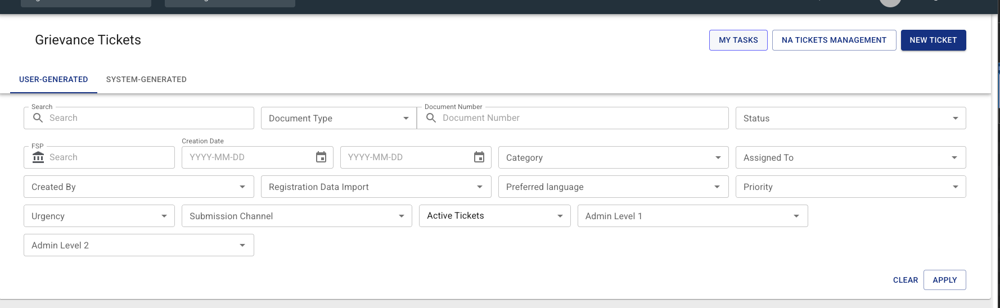
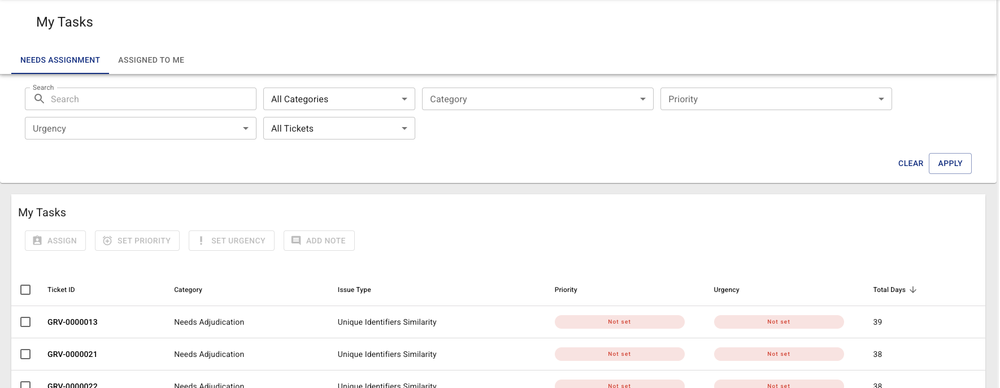
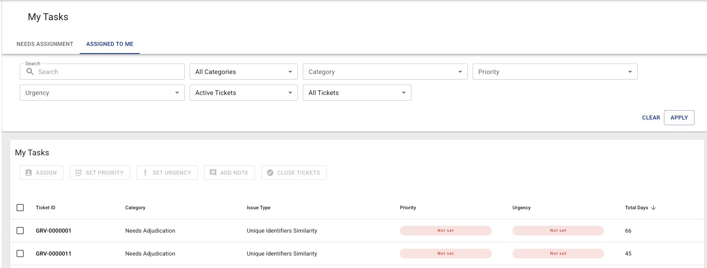
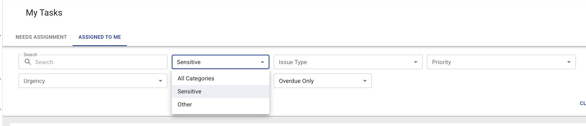
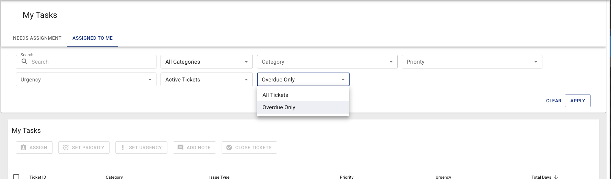

# My Tasks

**My Tasks** is a page for the tickets that wait on you: the unassigned ones waiting for somebody
with the right to assign them, the ones already assigned to you, and the ones sent for an approval
you may give. Each has its own tab, so none has to be dug out of the Grievance Tickets list, and
the tickets you have not looked at since somebody else changed them are marked as unread.

It is also where the [My Tasks emails](my-tasks-emails.md) land when a recipient follows a link.

---

## Getting there

The Grievance Tickets list carries a **MY TASKS** button in its page header:

!!! info "Works in both views"
    My Tasks opens in the All Programmes scope by default, because the tickets waiting for you can
    sit in any programme you have access to. Opened inside a single programme it lists that
    programme's tickets only, and the **Programmes** column disappears.

---

## The three tabs

| Tab | What it lists |
|---|---|
| **NEEDS ASSIGNMENT** | Every active ticket with no assignee that you are allowed to assign |
| **ASSIGNED TO ME** | Tickets assigned to you |
| **PENDING APPROVAL** | Tickets in the For Approval status whose category you may approve |

**NEEDS ASSIGNMENT** and **PENDING APPROVAL** list active tickets only, so they carry no
ticket-status filter.

**ASSIGNED TO ME** shows active tickets by default; switch its status filter to **All Tickets** to
include closed ones.

**PENDING APPROVAL** follows the approval grants per category: a ticket is listed when you hold the
approve grant for its category in its programme, the "as creator" grant and you created it, or the
"as owner" grant and it is assigned to you. Only tickets in an active programme are listed on any
tab.

Switching tabs clears your ticket selection: a ticket ticked on one tab can never be carried into a
bulk action on the other.

---

## The sensitivity filter

Both tabs carry a sensitivity filter:

| Choice | Shows |
|---|---|
| **All Categories** (default) | Everything you are allowed to see |
| **Sensitive** | Sensitive Grievance tickets only |
| **Non-Sensitive** | Everything except Sensitive Grievance |

The filter reshapes the **Category** list below it:

- On **Sensitive** the category is already settled, so the Category filter disappears and the
  **Issue Type** list is the sensitive one straight away.
- On **Non-Sensitive** the Sensitive Grievance option is removed from the Category list.
- On **All Categories** every category you may see is offered.

!!! info "When the filter is not shown"
    Viewing sensitive and viewing non-sensitive grievances are two separate grants. A user who holds
    only one of them has nothing to choose, so the filter is hidden and the list is fixed to the half
    they may see.

---

## The overdue filter

**Overdue Only** narrows the list to tickets past their due date. "Overdue" is measured from the
ticket's creation date against a threshold that differs by category — one day for sensitive
grievances, thirty days for everything else, both configurable. See
[Overdue thresholds](my-tasks-emails.md#overdue-thresholds).

Clearing it returns the list to all tickets rather than to "not overdue".

---

## The columns

My Tasks shows a narrower set of columns than the full ticket list: **Ticket ID**, **Category**,
**Issue Type**, **Priority**, **Urgency** and **Total Days**. The assignee is left out because each
tab already settles it. In the All Programmes scope a **Programmes** column is added.

The list is ordered by **Total Days**, longest-waiting first.

---

## Unread tickets

A ticket is unread when somebody else created it, assigned it to you, edited it, changed its status
or added a note after you last opened it. The full rule, and what never counts, is in
[What counts as unread](my-tasks-emails.md#what-counts-as-unread).

| Where | What you see |
|---|---|
| Tab label | A dot while the tab holds an unread ticket |
| Row | A dot before the ticket ID and a tinted row |
| **Only unread** filter | Narrows the tab to its unread tickets |
| **Mark all as read** | Marks every unread ticket on the tab as read; disabled while the tab has none |

Opening a ticket marks it as read. Mark all as read covers the whole tab, not only the rows on the
current page or matching the other filters. Opened inside a programme, the dots and Mark all as
read cover that programme's tickets only, like the list.

---

## Arriving from an email

The [My Tasks emails](my-tasks-emails.md) link straight into this page, one link per tab holding
an unread ticket. Opening the ticket, or **Mark all as read** on the tab, is what tells HOPE you
have seen it: once nothing is unread the reminders stop, and the next email comes only once
something else is waiting.

---

## Permissions

| Tab | Required |
|---|---|
| **NEEDS ASSIGNMENT** | `GRIEVANCE_ASSIGN` and any grievance list-view grant |
| **ASSIGNED TO ME** | any grievance list-view grant |
| **PENDING APPROVAL** | any grievance approve or close grant and any grievance list-view grant |

Only the tabs you hold permissions for are shown, and the first of them opens by default. A user
holding none of them does not get the **MY TASKS** button, and is refused the page if they open it
directly.

**NEEDS ASSIGNMENT** is scoped to the programmes you may assign in, and **PENDING APPROVAL** to the
programmes you may approve in. A programme you may only view has nothing on either tab for you to
act on.
