# Payment Plans, Payment Lists, Purposes, Follow-Up Instructions & Top-Ups

This guide covers the architectural features of the Payment Module:
**Payment Plan Purposes**, **Payment Plans and Payment Lists**, **Follow-Up Instructions**, and **Top-Up Payment Plans**.

!!! info "New names"
    What used to be called a Payment Plan Group is now a **Payment Plan**, and what used to be called a Payment Plan is now a **Payment List**.

---

## Payment Plan Purposes

A Payment Plan Purpose defines the intent of a payment — e.g. *Food Assistance*, *Education Support*, *Cash Transfer*. Purposes are global: they are created once by the Core Team and are available to all Business Areas and Programmes.

### Who manages Purposes?

Purposes are managed exclusively through the **Django admin panel** by the Core Team. Programme users cannot create or delete Purposes from the UI.

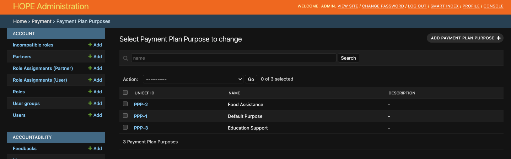

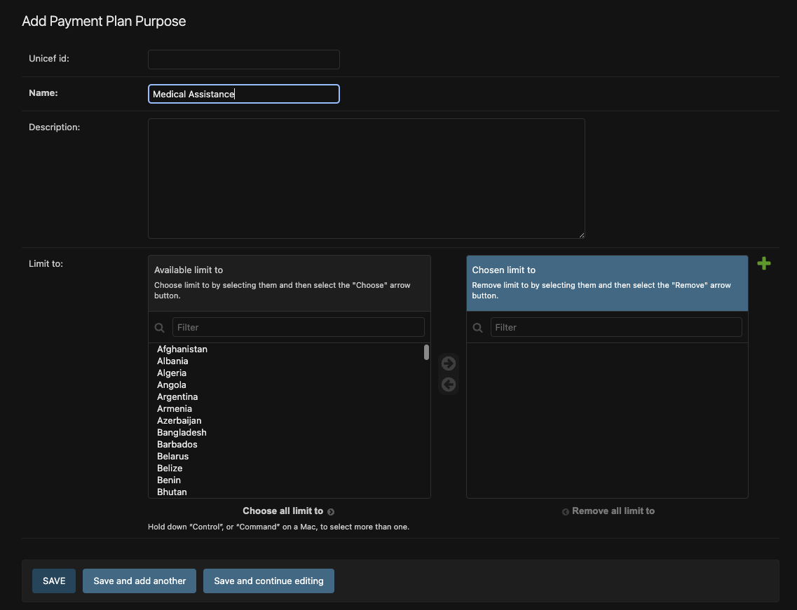

The `limit_to` field on each Purpose (an optional multi-select of Business Areas) is reserved for future use to restrict a Purpose's availability to specific offices. Until then, all Purposes are visible to all Business Areas.

### How Purposes are assigned

**At Programme level:**
When creating or editing a Programme, users select one or more Purposes for it (minimum 1, maximum 10). Purposes can be added or removed on update — but a Purpose can only be removed if **no Payment List in that Programme currently uses it**.

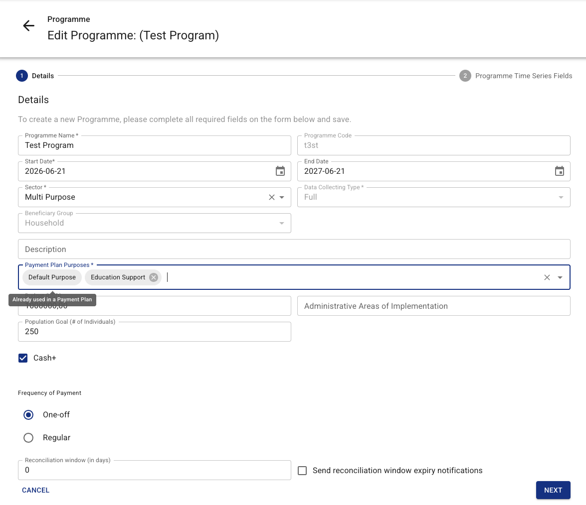

**At Payment List level:**
Purposes are selected during **Target Population creation** (the first step of the payment workflow). Users pick one or more Purposes from those already assigned to the parent Programme (minimum 1). After the Target Population has been created, Purposes may only be edited on the **most recently created** list in that cycle. Older lists' Purposes are locked.

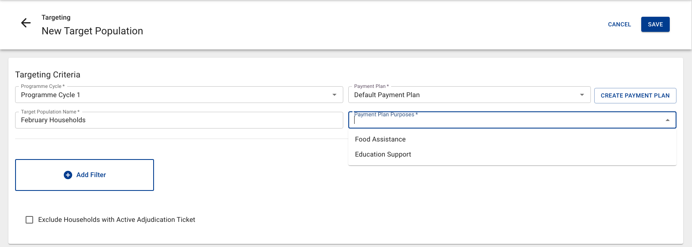

Follow-Up, Top-Up, and Top-Up Amendment lists **inherit Purposes automatically** from their source list — users do not select Purposes when creating them.

### Why Purposes matter for conflict detection

Two Payment Lists in the same Programme Cycle **conflict** for a given household if they share at least one Purpose. A household that is already entitled in List A (Food) cannot appear in List B (Food) — but it **can** appear in List B (Education) because the Purposes are disjoint.

| Scenario | Allowed? |
|---|---|
| List A [Food], List B [Education] — same household in both | ✅ Yes |
| List A [Food, Education], List B [Food] — same household in both | ❌ No (Food overlaps) |
| List A [Food], List B [Food] — same household in both | ❌ No |

---

## Payment Plans and Payment Lists

A **Payment Plan** is a container that collects one or more Payment Lists within the same Programme Cycle. A **Payment List** is created from one Target Population and holds its payments and entitlements. The lists of a plan share its FSP, currency and dispersion dates, and they are approved, exported, sent to the Payment Gateway, reconciled and closed together, on the Payment Plan page.

Every Programme Cycle automatically receives a Payment Plan named **"Default Payment Plan"** when the cycle is created. The name can be changed, and additional Payment Plans can be created manually.

### Creating a Payment Plan

On the **Cycle detail page**, click **"Create Payment Plan"** and provide a name. The name must be unique within the cycle. The same dialog takes the FSP, the currency and the dispersion start and end dates. They can also be set later with **Edit Payment Plan** on the Payment Plan page.

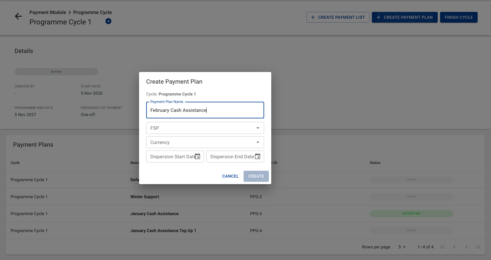

### Payment Plan settings

| Setting | When it can be changed |
|---|---|
| FSP | While every Target Population in the plan is still Open |
| Currency | Before the first Payment List of the plan is created |
| Dispersion start and end dates | While the Payment Plan is Open. A new end date has to be later than today |

A Target Population can be marked ready only when its Payment Plan has an FSP. A Payment List can be created from it only when the plan has a currency and dispersion dates, with an end date later than today.

### Assigning a Target Population to a Payment Plan

When **creating a Target Population** under a Cycle, the system asks for its Payment Plan:

- **Payment Plan** dropdown: lists the Open Payment Plans already in this Cycle; the new Target Population joins the chosen plan.
- **Create Payment Plan**: creates a new plan with a name you supply; the new Target Population is placed into it immediately.

A Payment List belongs to exactly one Payment Plan. While the Target Population is Open, **Change Payment Plan** on its edit page moves it to a new Payment Plan in the same Cycle. If you change the Cycle, you must also create a Payment Plan in the new Cycle.

A Target Population cannot join a Payment Plan that is no longer Open, or a Follow-Up, Top-Up or Top-Up Amendment Payment Plan.

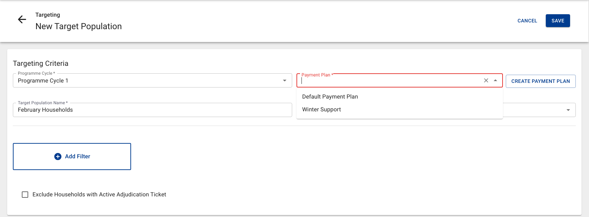

### Payment List operations

Until the Payment Plan is locked, each Payment List is worked on alone, on its own page: **Lock** and **Unlock**, entitlements, excluding beneficiaries and **Delete**. Payment Verification also stays on the Payment List.

### Payment Plan operations

A Payment Plan goes through these statuses: OPEN, LOCKED, IN APPROVAL, IN AUTHORIZATION, IN REVIEW, ACCEPTED, FINISHED, READY FOR CLOSURE and CLOSED. It can also be ABORTED. Once the plan is locked, its Payment Lists follow its status.

| Operation | Available when | What it does |
|---|---|---|
| **Edit Payment Plan** | Any status | Changes the name and the settings above. The new name must be unique within the Cycle |
| **Lock** | OPEN, the plan has an FSP, a currency and at least one Payment List, every list in it is LOCKED, and the FSP has an XLSX template for the delivery mechanism of each list | Locks the plan and moves its lists to LOCKED FSP. No Target Population can join a locked plan |
| **Unlock** | LOCKED | Returns the plan to OPEN |
| **Send For Approval** | LOCKED | Starts one approval process for the whole plan |
| **Approve**, **Authorize**, **Mark as released** | IN APPROVAL, IN AUTHORIZATION, IN REVIEW | Records the approval. When the required number is reached, the plan moves to the next status |
| **Reject** | IN APPROVAL, IN AUTHORIZATION, IN REVIEW | Returns the plan to LOCKED |
| **Abort** | LOCKED, IN APPROVAL, IN AUTHORIZATION, IN REVIEW | Aborts the plan and all its lists |
| **Reactivate** | ABORTED | Rebuilds the payees of every list and returns the plan to OPEN |
| **Export** | ACCEPTED, FINISHED | Produces a **single XLSX file** (one sheet) covering every Payment List in the plan. Once a file exists the button reads **Re-export**, and the new file replaces the old one |
| **Download XLSX** | A file has been exported | Downloads the exported file |
| **Send Xlsx Password** | The exported file is password-protected | Sends the file password |
| **Split** | ACCEPTED, until the plan is sent to the Payment Gateway | Splits every Payment List in the plan the same way |
| **Send to Payment Gateway** | ACCEPTED, with an FSP paid through the Payment Gateway | Sends each qualifying list in the plan to the payment gateway |
| **Upload Reconciliation** | ACCEPTED, FINISHED | Imports delivered quantities and distribution information from the plan's XLSX. See [Payment Reconciliation](payment-reconciliation.md) for normal uploads, corrections, and resets |
| **Set Ready for Closure** | FINISHED | Moves the plan to READY FOR CLOSURE |
| **Send Back** | READY FOR CLOSURE | Returns the plan to FINISHED |
| **Close** | READY FOR CLOSURE | Shows a summary over every list and closes the plan. A comment is mandatory unless at least one payment of every list has been verified in Payment Verification |
| **Delete** | The plan has no Payment Lists | Deletes the plan. A Cycle must always have at least one Payment Plan, so the last remaining plan cannot be deleted |

A plan turns FINISHED by itself once every payment in it is reconciled, and returns to ACCEPTED if a reconciliation is reset.

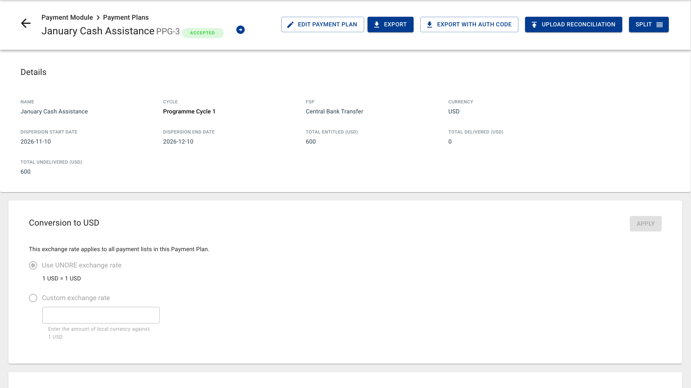

### Navigating Payment Plans in the UI

- **Cycle detail and Target Populations list** — lists are displayed under a **Payment Plan section header** that separates each plan's lists. The header links to the Payment Plan detail page.

  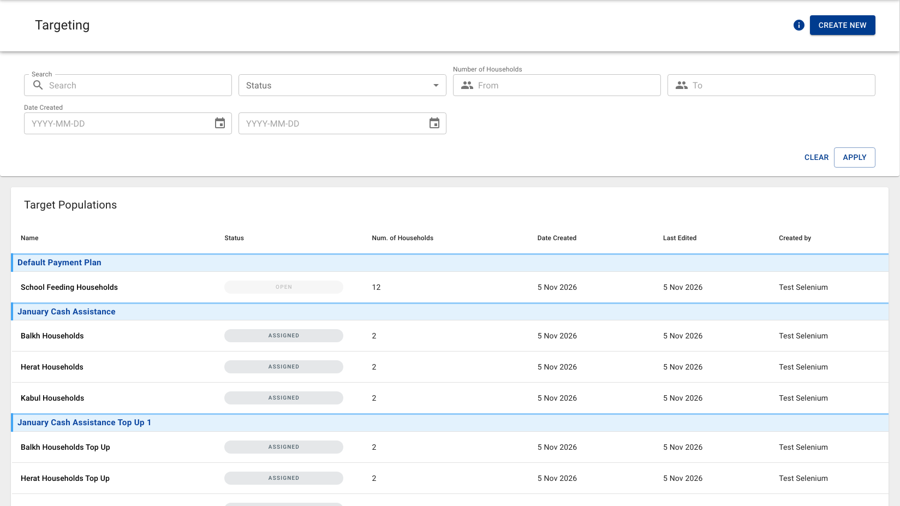

- **Payment List detail** — shows the assigned Payment Plan as a labelled field with a link to the Payment Plan detail page.

  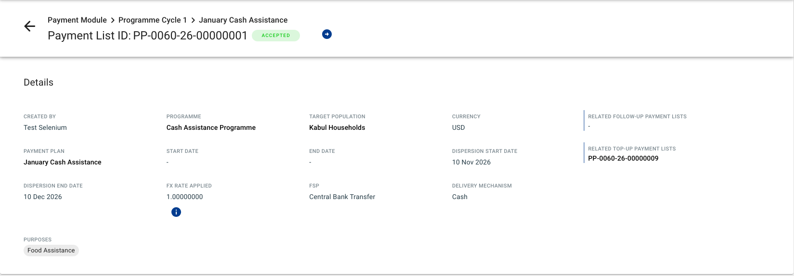

- **Payment Plans section** — top-level section in the Payment Module listing all Payment Plans (Cycle, name, Payment Plan ID, status).

  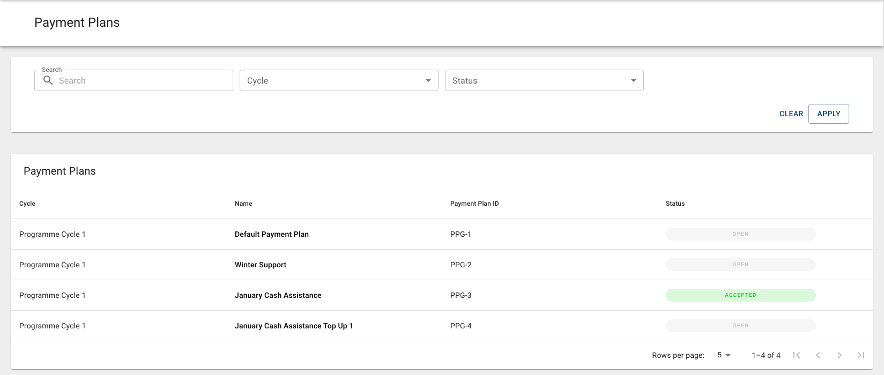

---

## Follow-Up Instructions

A **Follow-Up Instruction** is a batch container for follow-up payment lists generated from failed payments across one or more Payment Plans. When you create an instruction, the system automatically produces a separate Follow-Up Payment List for each eligible source list found in the selected plans. The instruction then provides a single combined export file and a unified reconciliation import covering all those follow-up lists.

All source lists in the selected plans must share the same FSP, delivery mechanism, and currency — the system validates this before creating the instruction.

### Follow-Up Instruction status

The status of a Follow-Up Instruction is **derived** from its child Payment Lists. The instruction shows the earliest workflow stage present among all its child lists (e.g. if any child list is still OPEN, the instruction shows OPEN).

### Creating a Follow-Up Instruction

Click **"Create Follow-up Instruction"** in the section Follow-up Instructions under the Payment Module. A dialog opens where you:

1. Select one or more **Payment Plans** from the same Programme.
2. Set the **dispersion start** and **dispersion end** dates.

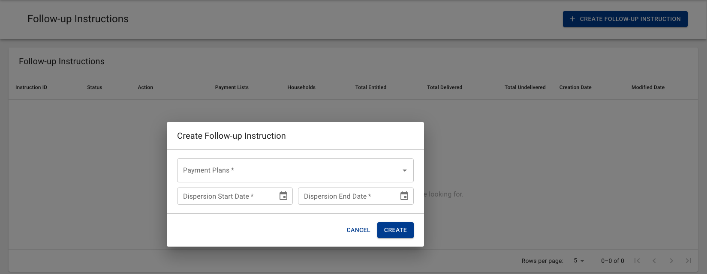

On submit, the system automatically creates a Follow-Up Payment List for every eligible source list found in the selected plans. A source list qualifies if it:

- Is not already managed by another Follow-Up Instruction.
- Has not yet had a follow-up list created from it.
- Has at least one payment in a failed or undelivered status eligible for retry.

Withdrawn households are excluded from each generated list.

### Processing Follow-Up Instructions

Follow-Up Payment Lists are processed through the **Follow-Up Instructions page**. These actions are not available from the individual Payment List page.
However, if a Payment Plan contains records with the Forced Failed status, the **Create Follow-up PP** button on the Payment Plan page is activated immediately. It creates a Follow-Up Payment Plan linked to the source plan, with one Follow-Up Payment List for each source list that has failed payments. That plan is processed on its own Payment Plan page.

To process Follow-Up Payment Lists, select the Follow-Up Instruction created as described above, and then choose the required action. Depending on the eligibility and current status of the lists, as well as the user’s permissions, available actions may include:

-	Lock
-	Send for Approval
-	Reject
-	Abort
-	Authorize
-	Release
-	Reconcile
-	Set as Ready for Closure
-	Send Back
-	Close

The selected action is applied to all eligible Follow-Up Payment Lists within the instruction.

### Exporting and reconciling Follow-Up Instructions

Follow-Up Instructions support the same export / import reconciliation cycle as Payment Plans, but at the batch level:

1. **Export XLSX** — generates a single file covering failed payments from all child lists within the instruction.
2. **Upload Reconciliation** — import the filled-in reconciliation XLSX; the instruction routes each row to the corresponding Follow-Up Payment List.

---

## Top-Up Payment Plans

A **Top-Up Payment Plan** (`plan_type = TOP_UP`) is used to make an additional payment to households that are already in a source Payment Plan in the same Cycle. It is a new Payment Plan linked to the source one, with one Top-Up Payment List for each source list that still has a beneficiary available. It can contain any household from those lists, whatever the status of their original payment — delivered, still pending, or failed.

### When can you create a Top-Up?

The **"Create Top-Up PP"** button appears on a regular Payment Plan in **Accepted** or **Finished** status that still has at least one beneficiary available to top up. Delivery is not required — a plan whose payments are all still pending can be topped up.

A beneficiary is available unless their household has been withdrawn, or they are already part of another Top-Up of the same source list: one Top-Up per beneficiary per source list.

!!! warning "Excluding a beneficiary does not free them"

    Excluding a payment from a Top-Up (or a Top-Up Amendment) does not return the beneficiary to the eligible pool. Being part of one child list of a source — excluded or not — blocks them from another one. Only beneficiaries who were never included stay available.

A Top-Up that contains failed payments can itself be the source of a Follow-Up Payment Plan, exactly like a regular plan.

### Setting the Top-Up amount

The amount is chosen while creating the Top-Up, in one of two ways:

- **Fixed** — one amount for every eligible beneficiary. Nobody is left out.
- **Custom / per beneficiary** — download the template, fill in an amount per beneficiary, and upload it. The file decides both the amounts and who is in: beneficiaries left empty or set to zero are not part of the Top-Up, and stay available for a later one.

This is how a source plan is split across several Top-Ups — fund some beneficiaries now, leave the rest at zero, and create another Top-Up for them later.

Before anything is submitted, the dialog reads the uploaded file in the browser and shows how many payments it would fund — for example *"New Top-Up will be created for 12 payments"*.

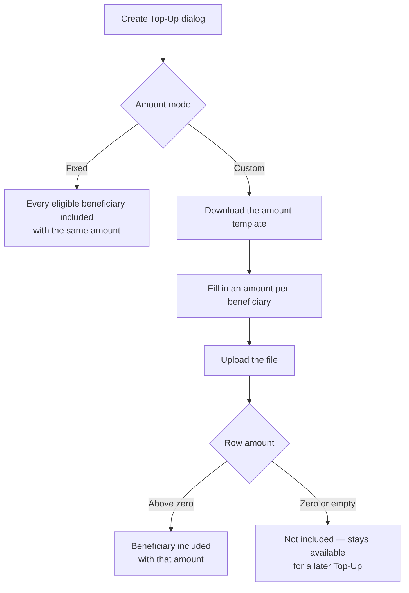

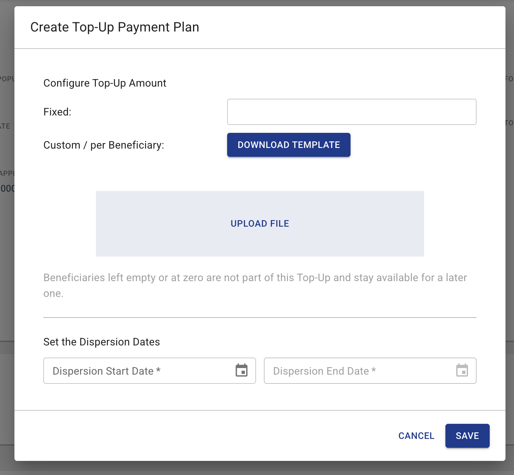

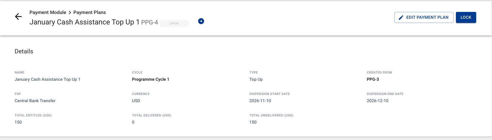

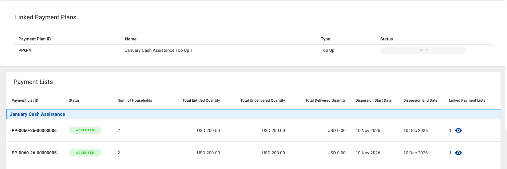

### What a Top-Up inherits

A Top-Up Payment Plan automatically inherits the source plan's **Programme Cycle, currency and FSP**, and each of its lists inherits the **Purposes and delivery mechanism** of its source list. Only the dispersion dates and the amount are chosen when creating it. Users do not select Purposes when creating a Top-Up.

The source plan lists its Follow-Ups, Top-Ups and Amendments under **Linked Payment Plans**. A linked plan shows its **Type** and a **Created from** link back to the source plan.

### Top-Up Amendments

A **Top-Up Amendment** (`plan_type = TOP_UP_AMENDMENT`) is a secondary correction layer on top of a Top-Up Payment Plan. It is created from a Top-Up Payment Plan (not from a regular plan) and adjusts the amounts of households within that Top-Up.

The **"Create Top-Up Amendment"** button appears on a Top-Up Payment Plan in **Accepted** or **Finished** status when at least one of its payments is on a non-withdrawn household and is not yet covered by another Amendment. As with a Top-Up, the payment's delivery status does not matter — delivered, pending and failed payments can all be amended.

The creation dialog is the same one used for a Top-Up: the amount is set either as a **Fixed** value for everyone, or per beneficiary by downloading the amount template and uploading it filled in. Beneficiaries left empty or at zero in the file are not part of the Amendment and stay available for a later one. Like a Top-Up, an Amendment inherits the source Top-Up's Programme Cycle, currency and FSP, and its lists inherit the Purposes and delivery mechanism of their source lists.

An Amendment that contains failed payments can be the source of a Follow-Up Payment Plan. An Amendment cannot itself be amended again.

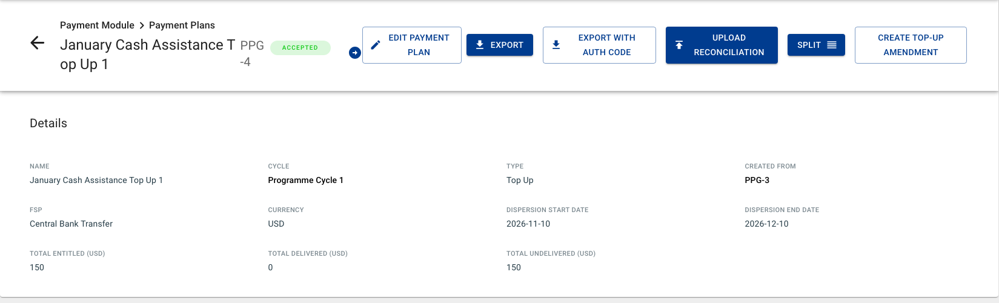

Creation-time funding of Top-Ups and Top-Up Amendments was introduced by [Change Request 332492: Improve the Top-Up Payment Plan workflow](https://dev.azure.com/unicef/ICTD-HCT-MIS/_workitems/edit/332492).
