# Payment Module

The Payment module is the payment management tool within HOPE that facilitates the creation of payment lists using information from targeted households. This module is used to create payment plans with payees and entitlements, track approvals and authorizations, create and export payment lists for payment providers (FSPs or IPs) and perform reconciliation with reports from payment providers.

Payment Plans and Payment Lists, Purposes, Follow-Up Instructions, Top-Ups and Top-Up Amendments are covered on their own page: [Payment Plans, Payment Lists, Purposes, Follow-Up Instructions & Top-Ups](payment-groups-and-purposes.md).

## HOPE and VISION Integration

When payments are provided through an Implementing Partner and are included in the Direct Cash transfer to the Implementing Partner, HOPE Payment Module currently does not fetch data from Vision. It is the responsibility of UNICEF programme manager to ensure that the cash to be transferred to beneficiary by the IP in the Cash Plan does not exceed the agreed DCT amount. Cash plans using a UNICEF FSP need to receive up-to-date financial data (approved with sufficient fund commitments) from Vision to be approved and released. Vision either provides,

1. Regular operation FC for payment when UNICEF has its own account with the FSP.
2. ezHACT functionality to be used when UNICEF pays through a FSP where UNICEF has no account.

## How to create a payment list

1. Select the Payment Module tab and choose your payment cycle, then click on “CREATE PAYMENT LIST” button.
    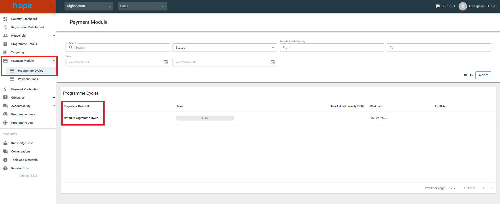

    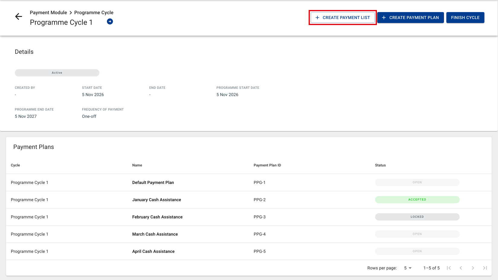

2. Select the corresponding target plan. The currency and the dispersion start and end dates come from the Payment Plan of the target population and are shown read-only. Set them on the plan (**Edit Payment Plan** on the Payment Plan page) before saving; the dispersion end date cannot be in the past.
    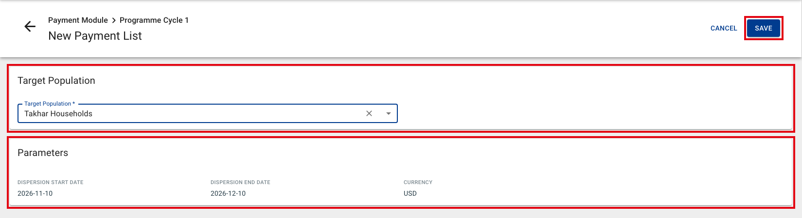

3. Once you click save, a summary of the payment list will be displayed for review. This includes the payment list ID, a summary of the payment list parameters and payees list. You also have an option to exclude households from the payment list by pasting a list of household IDs in the Exclude field (click CREATE to view the input box). Supporting documents are uploaded on the Payment Plan page by clicking the “UPLOAD FILE.”
    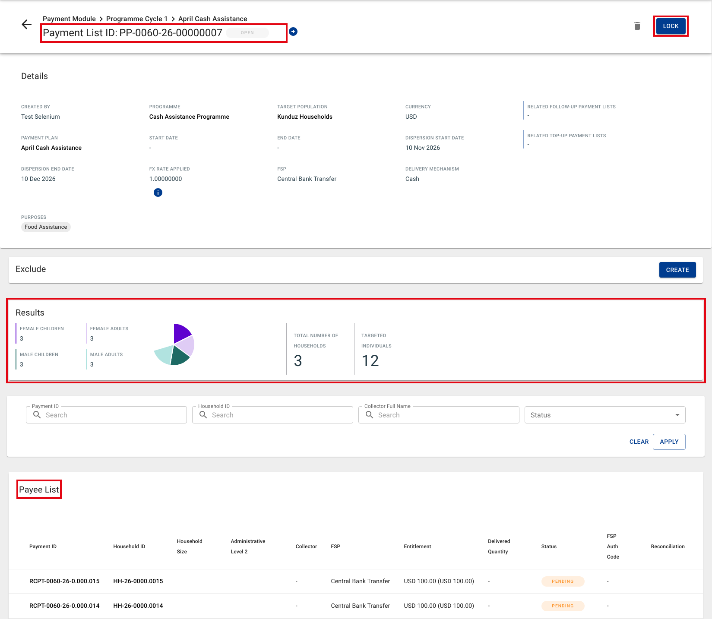

4. Two actions are available at this stage

    1. DELETE: removes the payment list.
    2. LOCK: locks the configuration of the payment list and allows creation of an entitlement formula. Once you lock the payment list, the status will change from OPEN to LOCKED

    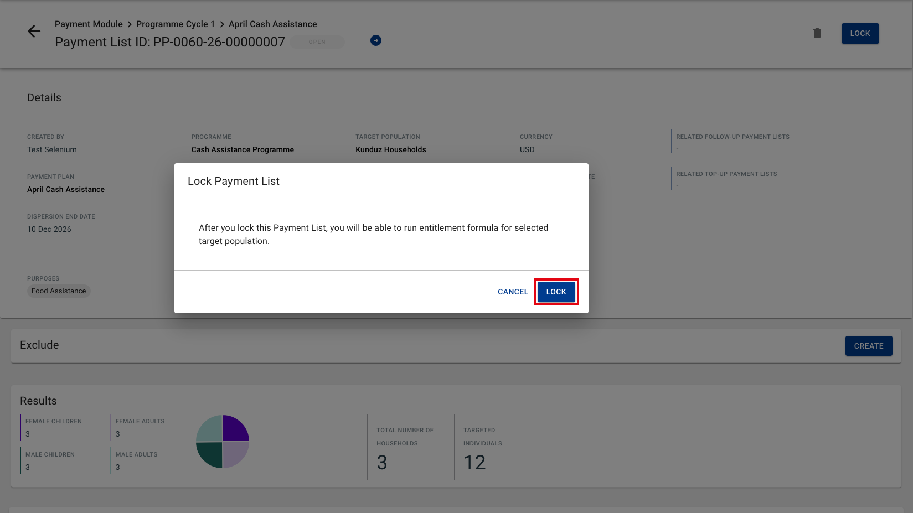

## Entitlement Formula

The entitle formula is used to define the amount that a household or individual should receive based on programmatic criteria. In the Payment Module there two options for setting up entitlement formulas:

1. Manual setup: this involves downloading the payment list (EXPORT XLSX), filling in the corresponding payment values and uploading the payment list (UPLOAD FILE) back to HOPE.

2. Custom setup: this involves submitting entitlement formula requirements to the HOPE support team for backend configuration in the HOPE. Once configured in HOPE, the entitlement formula will be available for selection on the ‘Select Entitlement Formula’ dropdown box.

    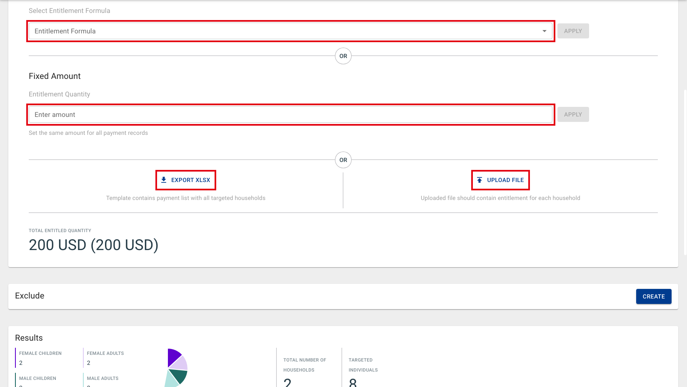

3. Open the Payment Plan page and click on LOCK. Every payment list in the payment plan has to be LOCKED first.
    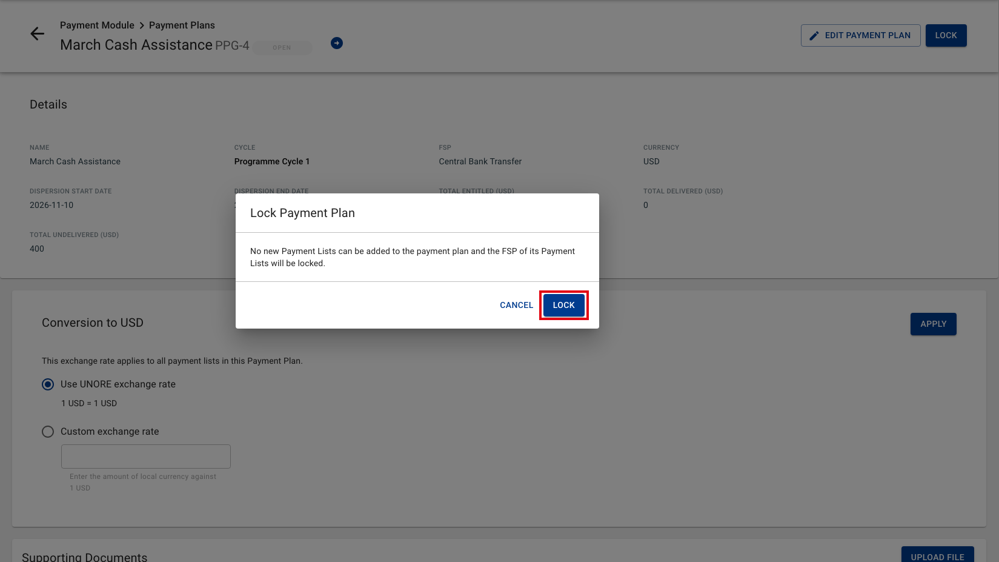

4. Send the payment plan for approval.
    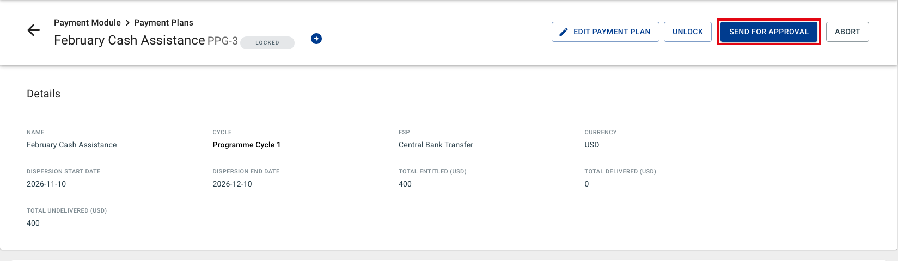

5. Click “APPROVE”, “AUTHORIZE” and “MARK AS RELEASED” to approve, authorize and release the payment plan.
    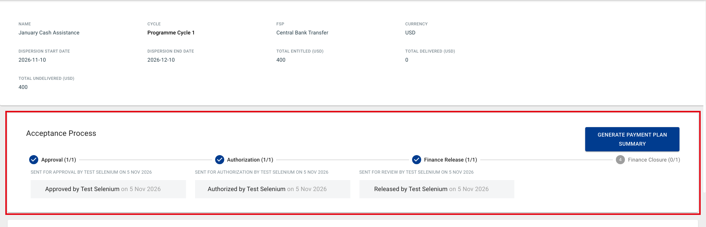

6. Click “EXPORT” on the upper right. Once the file is ready, the button changes to “RE-EXPORT” and “DOWNLOAD XLSX” appears next to it. Click “DOWNLOAD XLSX”.
    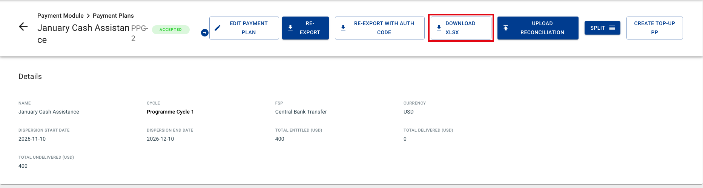

7. Fill out the column of DELIVERED QUANTITY in the excel that was downloaded in the previous step.
    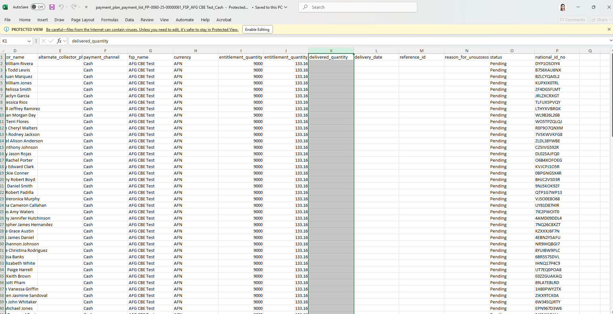
